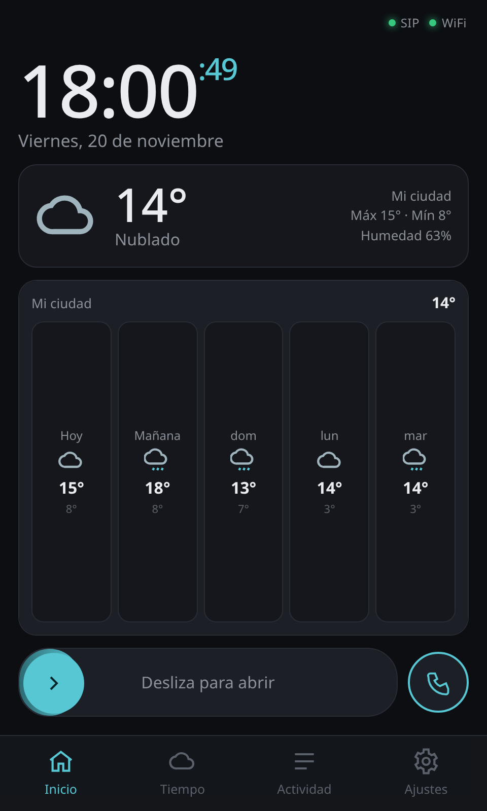
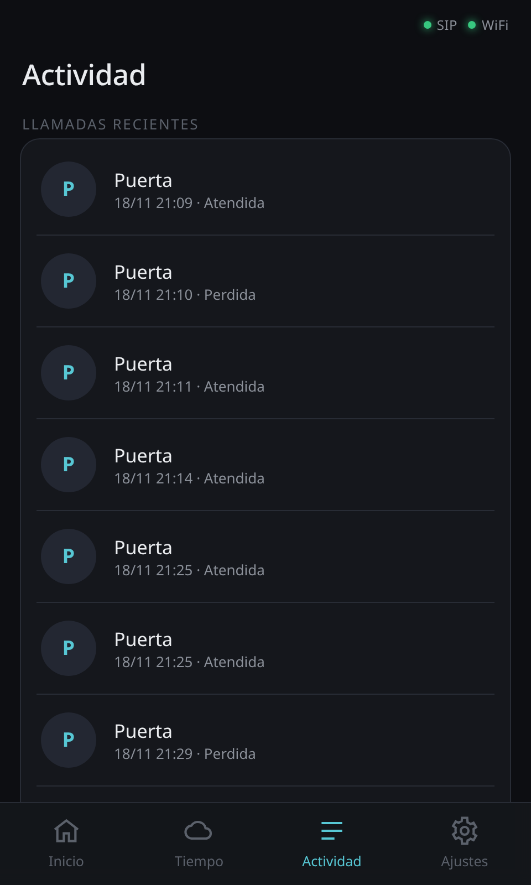
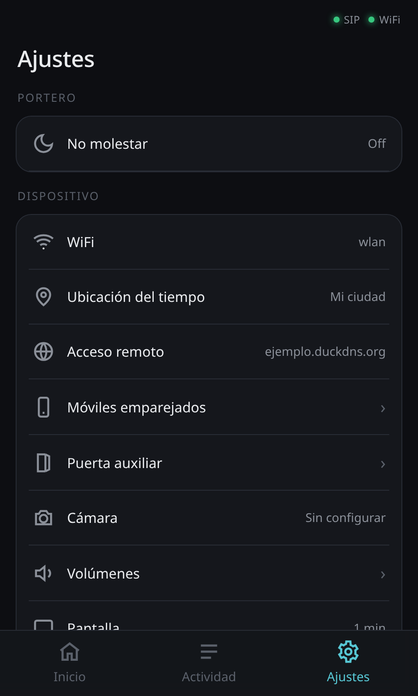
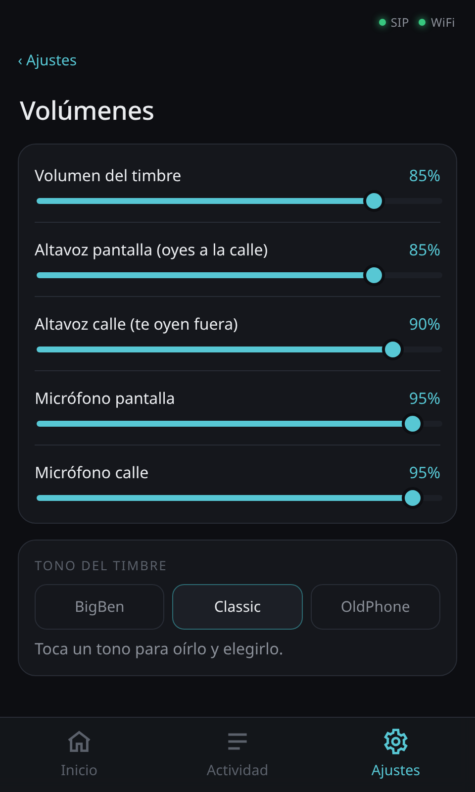
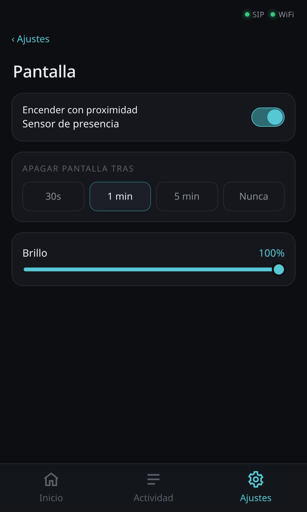
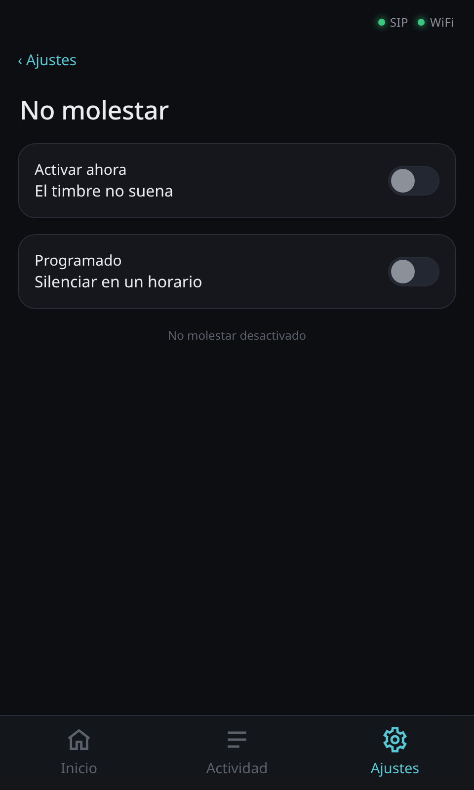

# UMBRAL — Videoportero open source

Firmware y herramientas **abiertas** para reutilizar, reparar y liberar la pantalla de videoportero **Qvadis One** (módulo Raspberry Pi **CM3+ / BCM2837B0**), que quedó inservible al cerrar la empresa y apagarse su nube.

Este proyecto sustituye el sistema de fábrica por **Raspberry Pi OS Lite** + una pila propia (kiosco, SIP sin nube, cámara, actualizaciones OTA con rollback y acceso remoto autoalojado), **sin depender de ningún servidor externo**.

> ⚠️ **Proyecto en desarrollo.** Puede contener errores y cambios que rompan la compatibilidad. Úsalo bajo tu propia responsabilidad.
>
> **Sin garantía de ningún tipo.** El autor **NO se hace responsable de ningún daño** (hardware, software, pérdida de datos o de servicio) causado a **cualquier equipo** por el uso de este proyecto. Trabaja **solo sobre equipos de tu propiedad** y haz una copia de seguridad antes de empezar.
>
> Proyecto comunitario **no afiliado** a Qvadis Innova, S.L. "Qvadis", "Fermax", "VDS/ADS" son marcas de sus respectivos titulares.

---

## Índice
1. [Qué hace](#qué-hace)
2. [Capturas](#capturas)
3. [Hardware soportado](#hardware-soportado)
4. [Instalación (liberar un equipo)](#instalación-liberar-un-equipo)
5. [Guía de usuario (la pantalla)](#guía-de-usuario-la-pantalla)
6. [Emparejar móviles](#emparejar-móviles)
7. [App móvil (UMBRAL)](#app-móvil-umbral)
8. [Acceso remoto (fuera de casa)](#acceso-remoto-fuera-de-casa)
9. [Actualizaciones (OTA A/B)](#actualizaciones-ota-ab)
10. [Seguridad](#seguridad)
11. [Arquitectura (para desarrolladores)](#arquitectura-para-desarrolladores)
12. [Estructura del repo](#estructura-del-repo)
13. [Limitaciones y hoja de ruta](#limitaciones-y-hoja-de-ruta)

---

## Qué hace

- **Pantalla táctil** 800×480 (rotada), con kiosco a pantalla completa (sin navegador visible), **arranque silencioso con logo** (no sale consola).
- **Videoportero**: cuando llaman desde la calle **suena en la pantalla y en los móviles** a la vez; se contesta en cualquiera, se habla y **se abre la puerta**.
- **Llamadas recientes** con **foto del visitante** (autocaptura al sonar; se guardan **30 días**).
- **Cámara** IP (MJPEG o RTSP transcodificado) cuando la hay; si no, se muestra **el tiempo**.
- **Puertas**: principal + auxiliar (relé) por GPIO.
- **Ajustes en pantalla** (teclado táctil): WiFi (con búsqueda), fecha/hora (auto o manual), brillo/apagado por inactividad y proximidad, volumen y micrófono, PIN, No molestar, acceso remoto/DDNS, actualizaciones.
- **Emparejar móviles** desde la pantalla: cada emparejamiento crea una **cuenta SIP** nueva con su **QR**.
- **Acceso remoto** autoalojado (SIP‑TLS cifrado, HTTPS con token, push FCM) para contestar y abrir desde fuera de casa.
- **Actualizaciones OTA A/B** con **rollback automático** (si una actualización falla, el equipo vuelve solo a la versión anterior). Incluye subir de versión el propio sistema operativo.

---

## Capturas

Pantallas reales del panel (datos de ejemplo):

| Inicio | Actividad | Ajustes |
|:---:|:---:|:---:|
|  |  |  |
| **Volúmenes** | **Pantalla** | **No molestar** |
|  |  |  |

---

## Hardware soportado

- **Qvadis One** con módulo **CM3+ (BCM2837B0)**, panel HDMI 800×480 y táctil **Goodix**.
- Audio: 2× tarjetas USB **C‑Media** (altavoz + micro, full‑dúplex).
- WiFi: **RTL8723BU** (interno de la placa portadora). Es un combo WiFi+Bluetooth; el **Bluetooth se deshabilita** a propósito (no se usa y su coexistencia en 2.4 GHz desestabiliza el WiFi).
- Retroiluminación en **GPIO7** (PWM invertido). Puertas en **GPIO24** (principal) y **GPIO26** (auxiliar). Timbre en **GPIO25**. Presencia (PIR) en **GPIO9**.

> El **adaptador QDS** (Qvadis DS Adapter, para porteros **Fermax ADS/VDS**) es un **módulo opcional** de audio. No es necesario: la función de "calle" se cubre con una placa IP (SIP) o un botón + abrepuertas por GPIO y una **cámara IP**.

---

## Instalación (liberar un equipo)

La liberación se hace **por SSH, sin hardware adicional**. Dos pasos:

### 1) `liberar.sh` — del sistema de fábrica a Raspberry Pi OS
En un equipo de fábrica accesible por SSH, instala Raspberry Pi OS Lite en la partición libre y conmuta el arranque.

> 🔑 **Acceso al equipo de fábrica (SSH):** la liberación necesita acceso *root* por SSH al sistema de stock. Las **credenciales/clave de servicio NO se incluyen en este repositorio** (son parte del firmware propietario y una misma clave podría abrir equipos de otras personas). Cada usuario debe **conseguirlas por sus propios medios** —hilos y foros de la comunidad, grupos de Telegram, etc.— y usarlas **únicamente en equipos de su propiedad**. Como alternativa sin esa clave: acceso físico a la eMMC con **IO board + `rpiboot`** para resetear la contraseña en `/etc/shadow` o añadir tu propia clave SSH.

```bash
sudo IMG=/ruta/raspios-lite-armhf.img.xz ./liberar.sh
```

> ⚠️ **Operación de ida.** El boot (p1) es compartido: al poner el firmware de RPi OS, el sistema de fábrica deja de arrancar. **Haz un backup completo antes** (desde tu PC):
> ```bash
> ssh root@<ip-de-la-pantalla> 'dd if=/dev/mmcblk0 bs=4M | gzip -1' > qvadis-backup.img.gz
> ```
> Sin IP pública tras CGNAT no afecta a este paso. La recuperación de un arranque roto requiere `rpiboot` + IO board.

### 2) `install.sh` — provisionar la pila Qvadis
Ya con Raspberry Pi OS Lite arrancado en la placa, desde la raíz de este repo:

```bash
sudo ./install.sh                      # interactivo (pregunta WiFi, SIP, PIN, zona)
sudo ./install.sh --answers config.local --yes   # desatendido (ver config.local.example)
```

> 🔒 **PIN de fábrica:** el instalador pregunta el PIN del panel y, si lo dejas vacío (o en modo desatendido sin `PANEL_PIN`), queda en **`1234`**. Como **Ajustes siempre exige PIN**, recuerda la contraseña y **cámbiala tras instalar** (Ajustes → Seguridad · PIN).

Instala dependencias, copia todo, configura panel/arranque, genera el certificado TLS, habilita servicios y monta el esquema **A/B** (segundo slot para el OTA). Reinicia y queda el videoportero funcionando.

Banderas: `--no-ab` (sin A/B), `--no-reboot`, `--yes`, `--answers FICHERO`.

---

## Credenciales y valores por defecto

El repositorio **no contiene contraseñas reales** (solo *placeholders* `CHANGE_ME`). Los secretos se fijan al instalar y puedes **personalizarlos**. Resumen de lo que trae de serie y dónde cambiarlo:

| Credencial | Valor por defecto | Cómo se fija / cambia |
|---|---|---|
| **PIN de Ajustes** | **`1234`** | `install.sh` lo pregunta (vacío = `1234`). Cambiar en **Ajustes → Seguridad · PIN**. |
| **Contraseña SIP del panel** (extensión `1000`) | la que pongas en `install.sh` (`SIP_PASS`) | `config.local` o el asistente. En el repo es `CHANGE_ME`. |
| **Contraseña SIP de cada móvil** | **aleatoria** al emparejar | se muestra en el **QR**; no se edita a mano. |
| **WiFi (SSID + clave)** | la que pongas en `install.sh` | **Ajustes → WiFi**, o `config.local`. |
| **Usuario `pi`** (SSH / rescate) | la que definiste al instalar Raspberry Pi OS | `passwd pi` (cámbiala tras liberar). |
| **Zona horaria** | `Europe/Madrid` | `config.local` (`TZ`) o **Ajustes → Fecha y hora**. |

Para una instalación **desatendida**, copia `config.local.example` → `config.local` y rellena:

```ini
WIFI_SSID="MiWiFi"
WIFI_PASS="mi-contrasena-wifi"
SIP_PASS="contrasena-sip"
PANEL_PIN="1234"
TZ="Europe/Madrid"
```

```bash
sudo ./install.sh --answers config.local --yes
```

> 🔒 **Cambia al menos el PIN (`1234`) y la contraseña del usuario `pi`** tras instalar. Las claves SIP de los móviles ya son aleatorias por emparejamiento.

---

## Guía de usuario (la pantalla)

### Inicio
- **Fecha y hora**, **el tiempo** (según tu ubicación) y, si hay cámara, su imagen.
- Botón **Teléfono**: llamadas recientes (con foto) y móviles emparejados.

### Cuando llaman a la puerta
Aparece una tarjeta **a pantalla completa** con el **vídeo de la cámara** de fondo (si hay): **Atender**, **Rechazar** y **Abrir**. Suena a la vez en los **móviles emparejados** y contesta quien lo haga primero. Durante la llamada puedes **Silenciar** tu micrófono (la calle deja de oírte), **Abrir** la puerta, **Colgar** o **hacer una Foto**. Si **atiendes en la pantalla**, se **corta la llamada a los móviles** (y al revés).

### Ajustes
Toca el icono de ajustes. Todo se escribe con el **teclado en pantalla**.

> 🔒 **Ajustes está protegido por PIN.** El firmware se instala con un **PIN de fábrica `1234`**, por lo que **Ajustes pide el PIN siempre** (es la entrada a toda la configuración; dentro no se vuelve a pedir). **Cámbialo en la primera instalación** (Ajustes → Seguridad · PIN).
- **WiFi**: muestra la red conectada; **Buscar redes** y cambiar escribiendo nombre + contraseña.
- **Fecha y dispositivo**: hora automática (NTP) o **manual** si la desactivas; info del equipo.
- **Pantalla**: brillo, apagado por inactividad y despertar por proximidad (PIR).
- **Volumen** (reproduce un tono al ajustar) y **micrófono** (volumen + prueba).
- **Seguridad · PIN**: cambia el PIN. **De fábrica es `1234`** y, como el firmware siempre trae PIN, **la entrada a Ajustes lo pide siempre**. Cámbialo al instalar.
- **No molestar**: silencia el timbre (manual o por horario).
- **Móviles emparejados**: lista de móviles y **Emparejar** (QR). Quitar con la ✕.
- **Puerta auxiliar**: activa/renombra la 2ª puerta (relé). Al activarla aparece su deslizable en Inicio.
- **Acceso remoto**: dominio/DDNS, IP pública y estado del push (ver abajo).
- **Actualización**: buscar/instalar actualizaciones; interruptor para desactivarlas.

---

## Emparejar móviles

**Ajustes → Móviles emparejados → Emparejar móvil** (Ajustes ya pide el PIN al entrar):
1. Escribe un nombre (p. ej. "Móvil de Ana").
2. Se crea una **cuenta SIP nueva** (extensión 1001, 1002… con contraseña aleatoria) y aparece un **QR + credenciales** (Servidor, Puerto, Usuario, Contraseña).
3. Configura un softphone (Linphone/Zoiper) con esos datos, **o** la app Android **UMBRAL** (en [`android/`](android/)), que **escanea el QR** y se autoconfigura.

El móvil entra automáticamente en el **grupo de llamada**: sonará cuando llamen a la puerta. Cada móvil se puede **quitar** con la ✕.

---

## App móvil (UMBRAL)

App Android nativa que convierte el móvil en un telefonillo del videoportero. Código en [`android/`](android/).

- **Descarga (APK):** [**umbral.apk** (última Release)](https://github.com/dazanestor/UMBRAL/releases/latest/download/umbral.apk) — *release* firmada para `arm64‑v8a`. Instálalo activando *"orígenes desconocidos"* en el móvil.
- **Qué hace:** recibe la llamada a pantalla completa con el **vídeo de la cámara** de fondo, **atender/colgar/abrir**, manos libres y silencio; **abrir con huella/PIN**; historial con fotos; y un **widget** de apertura rápida. Sigue registrada (servicio en primer plano) con **push FCM** de respaldo.
- **Emparejar:** **Ajustes → Móviles emparejados → Emparejar** en el panel y **escanea el QR** con la app; se autoconfigura (cuenta SIP, puertos, dominio y huella del certificado).
- **Compilar desde cero:** `cd android && ./build.sh` (descarga JDK 17 + Gradle portables). Para el push necesitas tu propio **`google-services.json`** (crea un proyecto en Firebase con el *package* `es.qvadis.app`, descarga el fichero y ponlo en `android/app/`); por eso no se incluye en el repo.
- **Licencia:** la app y el APK están bajo **GPLv3** (enlazan Linphone GPLv3) — ver [`android/LICENSE`](android/LICENSE).

> La app de fábrica de Qvadis (nube cerrada) **no** sirve; UMBRAL la sustituye y habla solo con **tu** placa.

---

## Acceso remoto (fuera de casa)

Para contestar y abrir **desde fuera**, sin nube de pago, autoalojado. Resumen:

- **Protocolos expuestos** (los que hay que **reenviar en tu router** hacia la placa):
  - **SIP‑TLS `5061/tcp`** — señalización cifrada; audio **SRTP** (cifrado).
  - **HTTPS `8443/tcp`** — cámara y abrir puerta, **con token** por móvil.
  - **Para el audio de las llamadas**: rango **RTP `10000‑10020/udp`** (mínimo; antes 10000‑20000).
  - **El SSH (22) NO se expone nunca.**
- **Dominio/DDNS**: configúralo en **Ajustes → Acceso remoto** (DuckDNS o URL genérica). La placa actualiza tu IP pública sola.
- **Certificado TLS**: autofirmado; la **app lo fija por pinning** (no hace falta Let's Encrypt). Su huella se entrega al emparejar.
- **Notificaciones push (FCM)**: al sonar el timbre, la placa despierta la app aunque esté en reposo. Requiere colocar tu `fcm-service-account.json` (de tu proyecto Firebase) en `/var/lib/qvadis/`. Sin él, el push queda desactivado (el resto funciona en LAN).

> **App Android:** la app nativa **UMBRAL** que consume este backend está en [`android/`](android/) (código y guía de compilación propia). Empareja escaneando el QR; recibe la llamada (servicio en primer plano siempre registrado + push FCM de respaldo), habla con manos libres/mute, abre con deslizable, ve la cámara y el historial, y trae un widget de apertura rápida con huella/PIN.

---

## Actualizaciones (OTA A/B)

La eMMC tiene **dos slots** iguales (A/B). Una actualización se instala en el **slot inactivo**, se arranca con **tryboot** y solo se promociona si arranca **sano**; si falla, **vuelve sola** al slot anterior. El registro, el WiFi y la configuración se conservan.

- **Ajustes → Actualización**: Buscar / Instalar. Comprobación automática en segundo plano.
- Soporta también **subir de versión el sistema operativo** (`apt full-upgrade` en el slot inactivo, con copia del boot y rollback). Los módulos del kernel se sincronizan a ambos slots para que el rollback siga siendo válido.
- Se activa fijando el repositorio en `/etc/qvadis-ota.conf` (`REPO="usuario/repo"`).

Herramienta: `qvadis-ota status|check|update|os-upgrade|confirm|rollback`.

---

## Seguridad

- **Superficie mínima**: solo **5061** (SIP‑TLS) y **8443** (HTTPS) se exponen; la API completa (HTTP 8080) y el control de baresip (4444) quedan en **localhost**.
- **HTTPS con token y allowlist**: en remoto solo pasa un conjunto cerrado de acciones —`abrir puerta`, `cámara`, `snap`, `llamadas`, `device`, `health`, el registro del token push y algunos ajustes del portero (volúmenes, timbre, no molestar)— cada una con el **token** de un móvil emparejado. Todo lo demás → 403.
- **PIN de Ajustes**: toda la configuración (móviles, WiFi, acceso remoto, reinicio, actualización) está detrás del PIN de entrada a Ajustes. **De fábrica `1234` → cámbialo en la instalación.**
- **Firewall nftables** (deny por defecto) y **fail2ban** (jail de Asterisk; SSH **no** se incluye porque **no se expone**).
- **Secretos**: el repo lleva **placeholders** (`CHANGE_ME`, `YOUR_WIFI_SSID`, …); `.gitignore` excluye claves, imágenes y backups.

---

## Arquitectura (para desarrolladores)

- **RPi OS Lite** (kernel 6.18 held), kiosco con **cog (WPE WebKit)** sobre **DRM/KMS** (`vc4-kms-v3d`), UI rotada 270° por CSS.
- **`manager.js`** (Node, sin dependencias, usuario `pi`): backend en `:8080` (HTTP local) y `:8443` (HTTPS remoto). Sirve la UI y la API (puertas por `pigpio`, cámara por `ffmpeg`, tiempo por Open‑Meteo, SIP/estado por Asterisk, OTA, DDNS, push FCM). Config en `/var/lib/qvadis/config.json`.
- **SIP sin nube**: **Asterisk** (canal **PJSIP**; `noload chan_sip`), panel como endpoint `1000` vía **baresip**, móviles dinámicos vía fichero incluido + grupo de llamada por variable `QV_RING`.
- **Audio**: intercom local calle↔pantalla por **PulseAudio** con **cancelación de eco** (webrtc) sobre las dos tarjetas C‑Media (calle/pantalla, resueltas por su **puerto USB físico** para que no se intercambien entre arranques); **baresip** comparte ese audio para las llamadas a móviles. Enables de amplificador/micro por GPIO.
- **Arranque**: `plymouth` (tema *umbral*), backlight por `pigpio` (GPIO7), silencioso.
- **OTA A/B**: `qvadis-ota` + `tryboot` (`cmdline.txt`/`tryboot.txt`), servicio de confirmación.
- **WiFi**: `wpa_supplicant@wlan0` dedicado (NetworkManager no asocia el rtl8xxxu) + servicio que recarga el módulo tras un reinicio en caliente.

---

## Estructura del repo

```
deploy/            Árbol que se copia al equipo (mirror de rutas del sistema)
  opt/qvadis-ui/   manager.js, www/ (UI), sonidos, vendor
  etc/             asterisk, systemd, wpa_supplicant, sudoers, nftables, fail2ban, boot
  usr/local/sbin/  qvadis-wifi, qvadis-ota
  var/lib/qvadis/  (config/estado en runtime)
android/           App Android UMBRAL (código Kotlin + build.sh)
apk/               umbral.apk (compilado para instalar)
liberar.sh         Stock → Raspberry Pi OS (por SSH)
install.sh         Provisiona la pila Qvadis (+ A/B)
config.local.example  Plantilla de respuestas para install.sh --answers
docs/              Documentación, PDFs de referencia y capturas (docs/screenshots/)
```

---

## Limitaciones y hoja de ruta

- **App Android nativa (UMBRAL)**: **implementada**, en [`android/`](android/) (Kotlin; Linphone SIP‑TLS/SRTP, OkHttp con pinning, FCM, ZXing). Compila con `android/build.sh` (JDK 17 + Gradle portables) → APK `arm64‑v8a`. Backend completo: SIP‑TLS/SRTP, HTTPS con token + pinning (puerta/cámara), push FCM al sonar, datos de emparejamiento por QR (token, huella del cert, puertos, dominio).
- **QDS (Fermax)**: integración **opcional** no implementada (requiere el módulo físico).
- **RTSP** validado por equivalencia (requiere una cámara RTSP real para confirmación final).
- **CGNAT**: si tu operador no te da IP pública, el acceso por puertos no funciona; haría falta VPN/malla o un relay (no incluido).

---

## Licencia y créditos

Proyecto comunitario de reparación y reutilización, **sin ánimo de lucro** y sin afiliación con el fabricante original.

**Licencias (por componente):**

- **Pila de la placa** (`manager.js`, `deploy/`, scripts, UI del panel): **[PolyForm Noncommercial License 1.0.0](LICENSE)** — puedes **usar, estudiar, modificar y compartir** libremente **para fines no comerciales**. **Nadie puede cobrar ni vender** productos o servicios basados en esta parte. Es *source-available* **no comercial** (no una licencia OSI clásica, precisamente porque esas sí permiten el uso comercial).
- **App Android** (`android/`) y el **APK** distribuido: **[GPLv3](android/LICENSE)**.

Componentes de terceros y sus licencias: ver [`THIRD-PARTY-NOTICES.txt`](THIRD-PARTY-NOTICES.txt).

"Qvadis", "Fermax", "VDS/ADS" son marcas de sus respectivos titulares; este proyecto no está afiliado a ellos.
